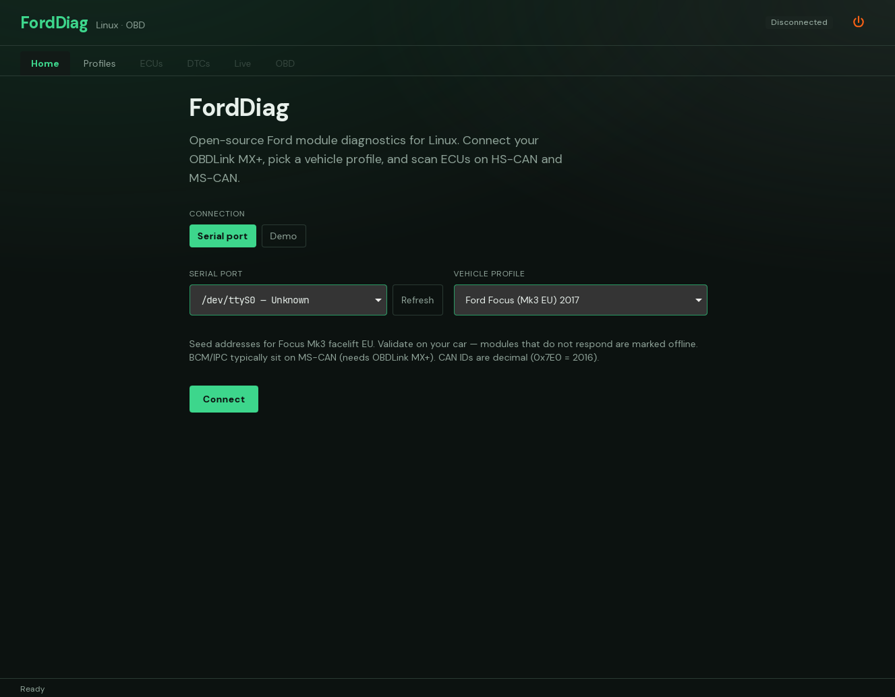
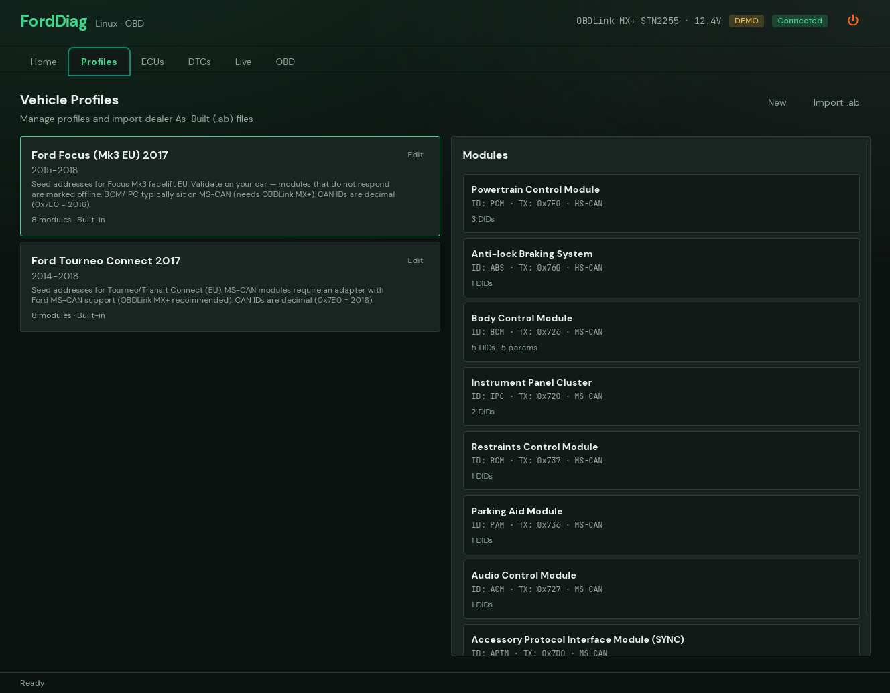
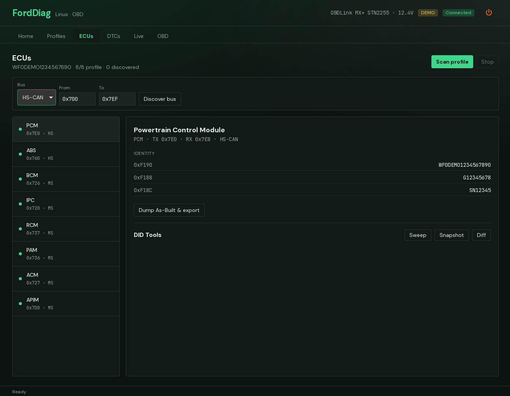
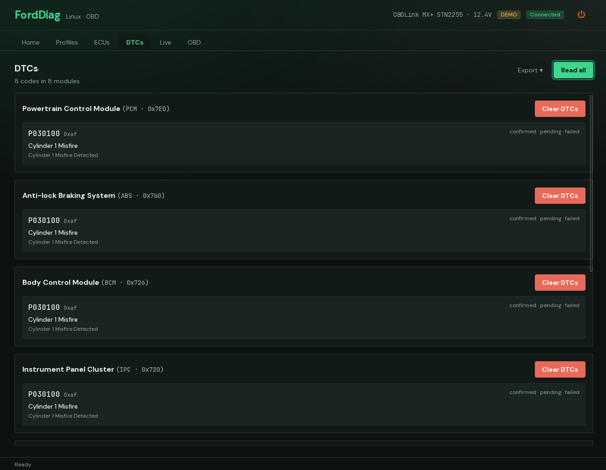
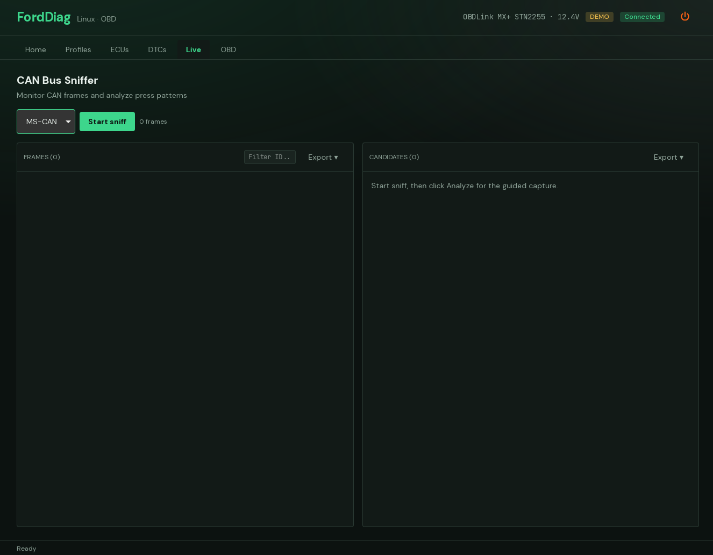
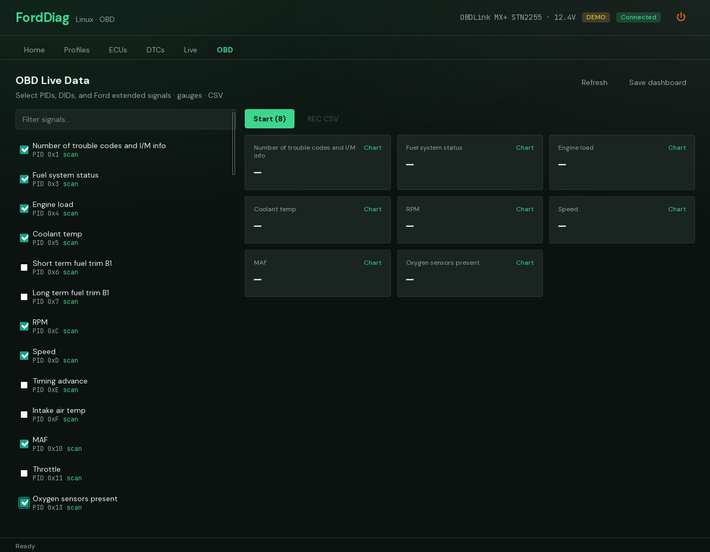

# Screenshots

Desktop UI of FordDiag (Tauri / Linux). Captured in demo mode unless noted.

## Home

Connection setup: serial or demo, port picker, vehicle profile.

## Profiles

Built-in vehicle profiles and module lists; import dealer As-Built (`.ab`).

## ECUs

Scan profile modules, discover on HS/MS-CAN, identity DIDs, As-Built dump.

## DTCs

Read and clear diagnostic trouble codes per module.

## Live

CAN bus sniffer and guided press-pattern Analyze.

## OBD

Live data: standard PIDs, DIDs, gauges, CSV recording.

